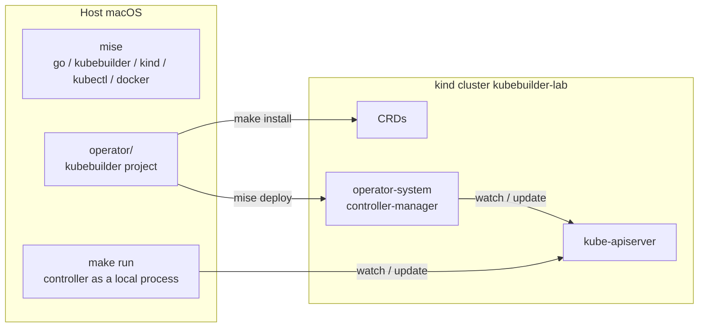

# lab-kubebuilder

A lab for building and running a custom controller with [Kubebuilder](https://book.kubebuilder.io/).
It starts one kind cluster and scaffolds a kubebuilder project in `operator/`, so you can go
through the full loop locally: scaffold, write the types, install the CRDs, run the controller.

- Tools and tasks live in [mise](https://mise.jdx.dev/) (`mise install` / `mise <task>`)
- Under this directory, kubectl / make / kind only see **the lab's own kubeconfig**
  (`.work/kubeconfig`), so `make run` and friends never reach another cluster
- The environment is ready. You generate the contents of `operator/` yourself with `mise init`

## Layout



There are two ways to run the controller.

| How | Command | Good for |
|---|---|---|
| Local process | `mise run-local` | Development. Fast restarts, logs go straight to the terminal |
| Deployment in the cluster | `mise deploy` | Checking RBAC and the image. Close to production |

## Getting started

```sh
mise trust && mise install   # first time only: install the tools
mise cluster-up              # create the kind cluster
mise init                    # scaffold operator/
```

Continue with [docs/01-handson.md](docs/01-handson.md).

## Tasks

| Task | What it does |
|---|---|
| `mise cluster-up` | Checks prerequisites and creates the kind cluster `kubebuilder-lab` |
| `mise cluster-down` | Deletes the kind cluster. The code in `operator/` is kept |
| `mise status` | Shows the nodes, this project's CRDs and the in-cluster controller |
| `mise init` | Runs `kubebuilder init` in `operator/` (skipped if already scaffolded) |
| `mise install-crds` | Installs the CRDs into the cluster (`make install`) |
| `mise run-local` | Runs the controller locally (`make run`) |
| `mise test` | Runs the tests with envtest (`make test`) |
| `mise deploy` | Builds the image, loads it into the kind node, then `make deploy` |
| `mise undeploy` | Removes the in-cluster controller and the CRDs |
| `mise logs` | Follows the logs of the in-cluster controller |

Tasks are run in the short form, `mise <task>`. The long form `mise run <task>` always works too.
The short form only works while the task name is not a mise command, which is why three tasks
are not simply called `up`, `install` and `run`: `mise up` upgrades the tools, `mise install`
installs them, and `mise run` is the task runner itself. If a later mise release adds a command
that matches a task name here, fall back to `mise run <task>`.

Commands that grow the scaffold, such as `kubebuilder create api` and `make manifests`,
are run directly inside `operator/`. The mise tools and `KUBECONFIG` apply in subdirectories too.

## Directory structure

```
├── mise.toml       # entry point: [tools] / [env] (KUBECONFIG) / [tasks]
├── docs/           # hands-on guide
├── kind/           # cluster config (one node)
├── scripts/        # what the tasks run (all idempotent)
├── operator/       # kubebuilder project (generated by mise init)
└── .work/          # the lab's own kubeconfig (gitignored)
```

kubebuilder generates a Makefile in `operator/`. It is kubebuilder's standard entry point, so it
is used as is rather than replaced. That Makefile installs pinned versions of controller-gen,
kustomize and setup-envtest into `operator/bin/`, which is why they are not in mise.toml.

## Versions

| Tool | Version | Notes |
|---|---|---|
| kubebuilder | 4.16.0 | Scaffolds with Kubernetes 1.37 / controller-runtime v0.25.0 / controller-tools v0.22.0 |
| go | 1.27.0 | The scaffold uses Go 1.26+ syntax |
| kind | 0.33.0 | |
| kubectl | 1.37.2 | |
| colima / docker-cli | 0.10.3 / 29.9.3 | |
